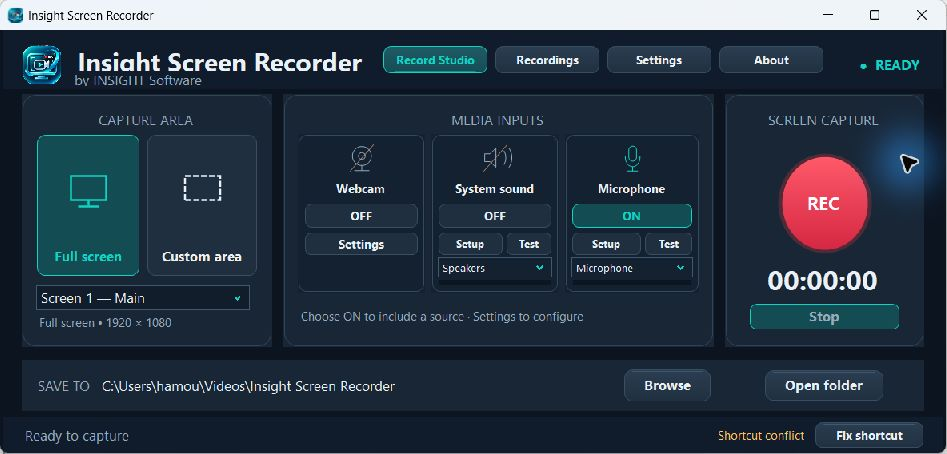
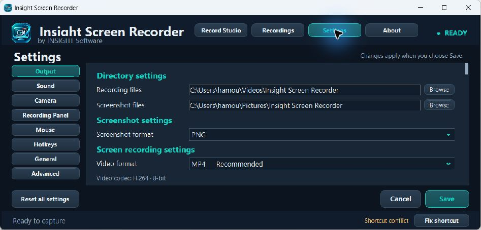

# Insight Screen Recorder

مسجّل شاشة لنظام Windows من **INSIGHT Software** — الإصدار **1.6.4 قيد التحقق**.

[English](README.md) · [ملاحظات الإصدار](RELEASE_NOTES.md) · [الدعم](SUPPORT.md)

> **حالة الإصدار:** وردت حالات تجمّد كامل للجهاز وتسجيلات ميكروفون صامتة، ولم يُحسم سببها بعد. لا تعتمد على هذه النسخة للتسجيلات المهمة. تجهيز المثبّت لا يعني اعتمادها للنشر العام؛ راجع [متطلبات النشر](PUBLISHING.md).

## الوظائف

- تسجيل الشاشة كاملة أو منطقة مخصصة، مع أسماء واضحة للشاشات.
- اختيار صوت النظام والميكروفون واختبار إشارة الصوت.
- عدّ تنازلي قبل البداية، وإيقاف مؤقت واستمرار ثم حفظ ملف واحد.
- حفظ MP4 أو MKV، والتقاط صور للشاشة.
- مكتبة تسجيلات للبحث والتشغيل وإعادة التسمية والحذف إلى سلة المحذوفات.
- إعدادات واختصارات، مع تنبيه لتعارض الاختصار.
- النسخة المجانية حتى 30 إطارًا/ثانية؛ Pro تضيف الكاميرا وحتى 60 إطارًا/ثانية وفق الترخيص وقدرة الجهاز.

التحقق من ترخيص Pro يحتاج الإنترنت. تُحفظ التسجيلات محليًا ولا يرفعها البرنامج تلقائيًا.

اللقطات حقيقية وغير معدّلة؛ حالة الأجهزة ومسارات الحفظ تعكس جهاز الالتقاط. تظهر لقطة الاستوديو الجديدة ميكروفون TX USB Audio متصلًا ومفعّلًا.

## التشغيل

بعد اعتماد التنزيل للنشر، تُرفق الملفات في تبويب Releases بالمستودع:

- 📥 **المثبّت المباشر (.exe):** [تحميل InsightScreenRecorder_Setup_1.6.4_x64.exe](https://github.com/alarifi/Insight-Screen-Recorder/releases/download/v1.6.4/InsightScreenRecorder_Setup_1.6.4_x64.exe)
- 📦 **النسخة المحمولة (.zip):** [تحميل InsightScreenRecorder_Win_x64.zip](https://github.com/alarifi/Insight-Screen-Recorder/releases/download/v1.6.4/InsightScreenRecorder_Win_x64.zip)
- 📋 **صفحة الإصدار وبصمات التحقق:** [صفحة إصدار v1.6.4 على GitHub](https://github.com/alarifi/Insight-Screen-Recorder/releases/tag/v1.6.4)
- مسار التثبيت الافتراضي: `C:\Program Files\Insight Tools`.
- Windows بمعمارية x64؛ لا يحتاج المستخدم إلى SDK أو تثبيت .NET منفصل.

المثبّت غير موقّع رقميًا. تحقق من بصمة SHA-256 المرفقة. إزالة البرنامج لا تمسح تسجيلاتك أو إعداداتك المحفوظة في ملف المستخدم.

قبل التسجيل، فعّل المصدر المطلوب واستخدم Test وتأكد من تحرك مؤشر الصوت. ظهور ON وحده لا يثبت وصول صوت الميكروفون.

## تقييمك يساعدنا

إذا استحق البرنامج **5 من 5** يسعدنا تقييمك الصادق بخمس نجوم. نرحب بجميع التقييمات من 1 إلى 5 عبر **Issues → New issue → Rate your experience**، مع اقتراحات التحسين.

يمكنك دعم المستودع بزر **⭐ Star**. هذا الزر منفصل عن نموذج تقييم المنتج من خمس درجات؛ لا نعرض تقييمات أو شهادات مستخدمين مختلقة.

البرنامج مملوك لـ INSIGHT Software وفق [الترخيص](LICENSE.txt). للمكونات الخارجية تراخيص مستقلة موضحة في [إشعارات المكونات](THIRD_PARTY_NOTICES.md).
