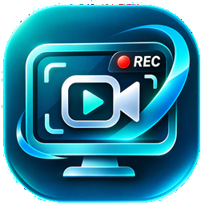
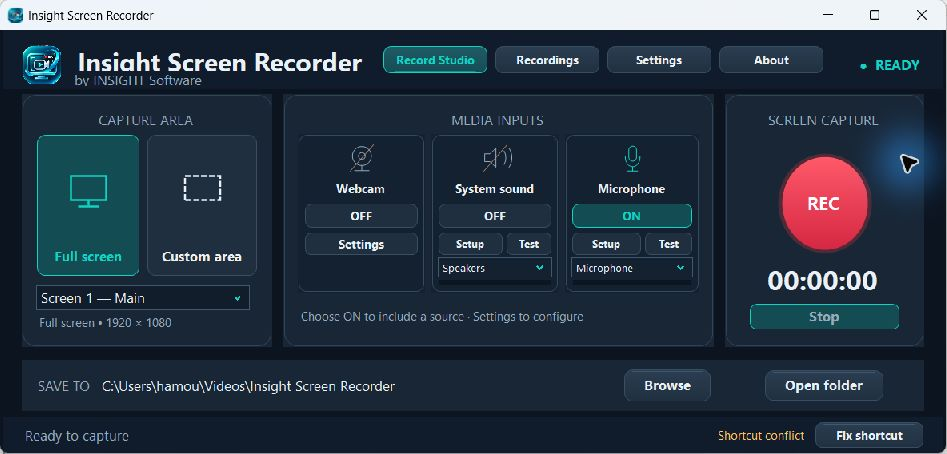
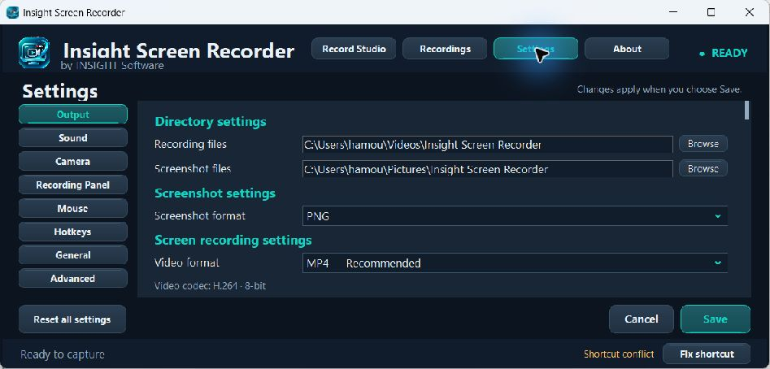

<p align="center"></p>

<h1 align="center">Insight Screen Recorder</h1>
<p align="center">A focused Windows recording studio by <strong>INSIGHT Software</strong>.</p>
<p align="center"><strong>Windows x64 · .NET 10 · Version 1.6.4 · Validation build</strong></p>

[العربية](README.ar.md) · [Release notes](RELEASE_NOTES.md) · [Support](SUPPORT.md) · [License](LICENSE.txt)

> **Release status:** This build is being evaluated. Whole-computer freezes and silent microphone recordings were reported on the development computer and have not been conclusively resolved. Do not rely on this build for important recordings. Public binary release has not been cleared; see [publishing requirements](PUBLISHING.md).

## Record, pause, resume and save



Choose a display or custom area, enable the sound sources you need, and start recording after the countdown. The large REC control becomes Pause/Resume; Stop finishes the recording.

## Features

- Full-display and custom-area recording, with friendly monitor names.
- System sound and microphone selection, input tests and signal meters.
- Pause/Resume with one final MP4 or MKV file; paused time is excluded.
- Configurable countdown, with a three-second default.
- Screenshots, Browse and Open folder actions, and optional automatic folder opening after save.
- A recording library with search, durations, playback, rename and Recycle Bin deletion.
- Settings and keyboard shortcuts with shortcut-conflict feedback.

| Edition | Frame rate | Camera overlay |
| --- | --- | --- |
| Free | Up to 30 FPS | Not included |
| Pro | Up to 60 FPS | Included with an active license |

Actual performance depends on the computer and selected devices. Pro activation and verification require the online INSIGHT licensing service; recordings are saved locally and are not automatically uploaded.

## Settings



These are unedited captures of the application. Device availability and paths reflect the computer at capture time; the refreshed studio image shows the connected TX USB Audio microphone enabled. The screenshot is not a recording-quality certification.

## Installation and portable use

When a download is approved for distribution, use the repository's **Releases** tab. Binary files belong in release attachments rather than source commits.

- Installer: `InsightScreenRecorder_Setup_1.6.4_x64.exe`.
- Portable: `InsightScreenRecorder_Win_x64.zip`.
- Default installer directory: `C:\Program Files\Insight Tools`.
- Requires Windows x64 and compatible capture/audio devices. No separate .NET runtime or SDK is needed by end users.
- Extract the whole portable ZIP, then run `InsightScreenRecorder.exe`. Keep its DLLs and `tools` folder intact.

The installer is unsigned. Verify the provided SHA-256 checksum before use. Uninstalling preserves recordings, screenshots, settings and protected license data in the user's profile.

## Quick start

1. Choose Full screen or Custom area and select the correct display.
2. Enable System sound and/or Microphone. Use Test and confirm a moving input meter before recording.
3. Press REC and wait for the countdown.
4. Pause or resume with the large control; choose Stop to save.
5. Open the folder or find the result in Recordings.

If a microphone meter stays flat, check the selected device, headset connection and physical mute switch. An ON button does not establish that speech is reaching the input. See [support](SUPPORT.md).

## Build from source

The full repository uses `Build/src` for source and `Build/tests` for regression harnesses. Building requires Windows, .NET 10 SDK and its required runtime packs, local FFmpeg/FFprobe tools, PowerShell and a compatible Inno Setup 6 compiler.

```powershell
& .\Build\Build-Release.ps1
& .\Build\Verify-Release.ps1
& .\Build\Build-Installer.ps1
```

The build defaults to runtime 10.0.13. Provision missing dependencies first; NuGet restore can use the network. App builds preserve the previous Release in Archive. See the build scripts for exact requirements. This presentation kit alone is not the application source distribution.

## Rate your experience

If Insight Screen Recorder earns **5/5**, we would appreciate your honest five-star feedback. All ratings from 1 to 5 are welcome: use **Issues → New issue → Rate your experience** and tell us what worked and what needs improvement.

On GitHub, **⭐ Star** bookmarks and supports the repository; GitHub's Star button is separate from a five-point product rating. No ratings, review totals or testimonials are claimed here.

## Licensing

The application is proprietary; see [LICENSE.txt](LICENSE.txt). Publishing source does not imply an MIT or other open-source grant. FFmpeg, FFprobe and Microsoft .NET retain their own licenses; see [third-party notices](THIRD_PARTY_NOTICES.md).

© 2026 INSIGHT Software.
